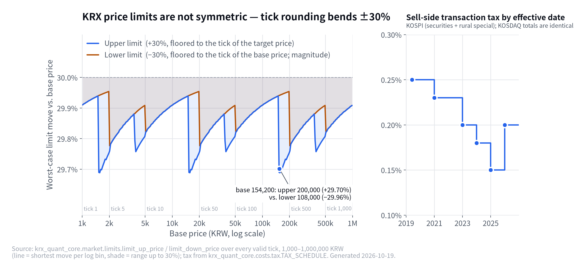

<div align="center">

<picture>
  <source media="(prefers-color-scheme: dark)" srcset="docs/images/brand/wordmark-dark.svg">
  
</picture>

# krx-quant-core

**A shared core where Korean equity quant systems align on market rules in one place.**

Upper and lower price limits are asymmetric, transaction taxes vary by effective date, and out-of-sample windows open only once. No strategies live here.

[](https://github.com/younghwan91/krx-quant-core/actions/workflows/ci.yml)
[](https://www.python.org/)
[](LICENSE)
[](https://www.linkedin.com/in/younghwan-chae/)

[Quick start](#quick-start) · [Reference Guide](docs/guide.en.md) · [한국어](README.md) · [Issues](https://github.com/younghwan91/krx-quant-core/issues)

</div>

<picture>
  <source media="(prefers-color-scheme: dark)" srcset="docs/images/hero-dark.png">
  
</picture>

<p align="center"><sub>Asymmetric upper/lower price limit skew by base-price band and securities transaction tax steps by effective date</sub></p>

- **Upper and lower limits are asymmetric.** From a 154,200 KRW base price, limit-up is 200,000 KRW (+29.70%) and limit-down is 108,000 KRW (−29.96%). Across 130 `daily_bars` rows where rules diverge, the symmetric formula matched 25 rows while the asymmetric formula matched 105 ([empirical check](docs/guide.en.md#price-limits--empirical-verification)).
- **Transaction taxes depend on the date.** Six steps from 0.25% in 2019 to 0.15% in 2025 and 0.20% in 2026. Cost functions take the trade date and apply that day's rate.
- **Out-of-sample windows open once.** The run ledger locks OOS ranges in git, and final evaluation can be started only once per label. Retries are refused.

## Quick start

```bash
pip install krx-quant-core==0.9.0            # extras: [fast] numba · [opt] optuna · [db] psycopg · [evo] cmaes
```

```python
from datetime import date
from krx_quant_core.market import Market, limit_up_price, limit_down_price, shift_ticks
from krx_quant_core.costs import round_trip_cost, tax_rate

limit_up_price(24_250)          # 31500
limit_down_price(239_000)       # 167500.0
shift_ticks(49_950, 2)          # Decimal('50100') — valid tick even across band boundaries
tax_rate(date(2025, 6, 2), Market.KOSPI).total   # Decimal('0.0015')
round_trip_cost(date(2026, 9, 14), Market.KOSDAQ, slippage_one_way=0.0015)  # 0.0053
```

Requires Python 3.11 or later. Required dependencies are only `kiwoom-client` (canonical tick-size table), `numpy`, and `pandas`. Without `[fast]`, the same kernels run in pure Python and produce identical numbers.

```bash
# If you need unreleased features, pin a commit on main:
pip install "krx-quant-core @ git+https://github.com/younghwan91/krx-quant-core@<commit-sha>"
```

## What's Inside

| Module | Purpose |
|---|---|
| `market/` | Ticker normalization & `Market`, tick sizes (scalar, vectorized, ETF), price limits, KST sessions, trading calendar |
| `costs/` | Effective-date tax schedule, `KoreanCostModel` (`Decimal`), `round_trip_cost` (`float`), `impact` (square-root impact) |
| `execution/` | `OrderManager`, `InstanceLock`, `PositionBook`, `Broker` (`PaperBroker`, `KiwoomBroker`), `EngineCore`, `OrderGuard` |
| `risk/` | DART material disclosure classification & `RiskGate`, `DartDisclosureDB`, `KillSwitch`, `factor_model`, `attribution` |
| `backtest/` | Order-book sweep VWAP & round-trip cost, limit-order fill rules, trade-ledger metrics, cross-sectional sim, `replay`, `drift`, `ticktime` |
| `backtest/lob/` | Ticks & quotes → 1s grid features & paths (shared batch/live kernel), episode sim, random control, limit-order queue model, `ceiling` |
| `data/` | Single `COPY` read from shared DB into columnar `.npy` + `mmap`, daily/minute/tick/quote cache, regular-session base-price recovery, `risk_inputs.load_risk_inputs` |
| `stats/` | Deflated/Probabilistic Sharpe, t-haircut, purged walk-forward, bootstrap, fragility, selection bias, stratified matched control, `ic` |
| `portfolio/` | `optimize` — constrained mean-variance optimization over the factor risk model (requires `[portfolio]` extra) |
| `research/` | `run_sweep` (grid, parallel, cached), `optuna_search`, `evolve` (BIPOP CMAwM, generation protocol, paired racing, sealing) |
| `runtime/` | Host guard, `start_run` ledger, OOS hard lock, `kqc` CLI (remote execution, `nightly`, `pins`) |

Each strategy repository pins an exact `krx-quant-core==X.Y.Z` release.

| Consumer | Style | Execution | Used from this package |
|---|---|---|---|
| [scalp-it](https://github.com/younghwan91/scalp-it) | Scalping | Automated live | Ticks, price limits, order guard, book sweep, fill rules, host guard |
| [daytrade-it](https://github.com/younghwan91/daytrade-it) | Day trading | Automated live | Cost model, disclosure risk gate, DART DB, code normalization, host guard |
| [swing-it](https://github.com/younghwan91/swing-it) | Swing | Research + manual | DSR, purged CV, bootstrap, fragility diagnostics, cross-sectional sim, evolution engine, optimization |

## Why Extract It

Three repositories each maintained their own copies of the same rules, and they had drifted apart.

- **Divergent ticker normalization**: `normalize_code` was copy-pasted across two repos; one old implementation turned `0155E0` into `001550` (a completely different company).
- **Scattered cost constants**: Transaction costs varied across repos (`0.0023`, `0.0034`, `0.0064`, `50bp`), and no code applied the 2023–2026 tax steps by date.
- **Inverted fill assumptions**: When given an unknown value, one place treated it as `through` while another in the same repo treated it as `touch`.
- **Missing lower limits**: There was no lower-limit calculation; symmetric formulas get it wrong.

Four design principles govern the core: **numerical parity** on migration against original code, **no pass/fail judgments** from statistical functions, **explicitly flagging unverified broker fields** (`False` defaults), and **never revoking shared app-key tokens** on disconnect.

## Docs

| Doc | Contents |
|---|---|
| [Reference Guide](docs/guide.en.md) | Price limits check, tax schedule, run ledger & OOS lock, live safety rules, LOB fill assumptions, edge evaluation axes, data layer, search & evolution, development, roadmap |
| [Design Specs](docs/superpowers/specs/) | Rationale and design decisions per module |
| [Implementation Plans](docs/superpowers/plans/) | Version-by-version implementation plans |
| [Release Process Diagram](docs/diagrams/release-process.html) | Interactive release and pin-sync workflow |

## Contributing & Support

- Report bugs, ask questions, or propose features via [GitHub Issues](https://github.com/younghwan91/krx-quant-core/issues).
- See the [Development section in the Reference Guide](docs/guide.en.md#development) for local setup and test commands.
- **Author**: **Younghwan Chae (채영환)** · [GitHub @younghwan91](https://github.com/younghwan91) · [LinkedIn](https://www.linkedin.com/in/younghwan-chae/)

## License

[Apache-2.0](LICENSE)
