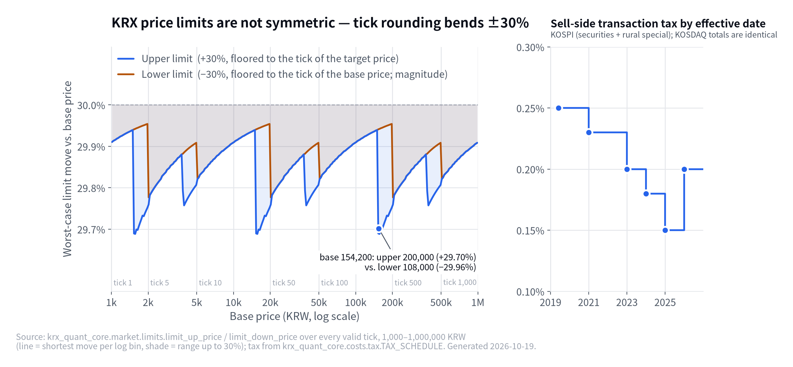

# krx-quant-core

**한국 주식 퀀트 시스템이 시장 규칙을 한 군데서 맞추는 공통 코어.** 상·하한가는 대칭이 아니고,
거래세는 시행일마다 다르고, 표본 외 구간은 한 번만 연다. 전략은 여기 없다.

[](https://github.com/younghwan91/krx-quant-core/actions/workflows/ci.yml)
[](LICENSE)
[](https://www.python.org/)
[](https://www.linkedin.com/in/younghwan-chae/)

<picture>
  <source media="(prefers-color-scheme: dark)" srcset="docs/images/hero-dark.png">
  
</picture>

- **상한가와 하한가는 대칭이 아니다.** 기준가 154,200원의 상한가는 200,000원(+29.70%), 하한가는 108,000원(−29.96%).
  `daily_bars` 에서 규칙이 갈리는 130행 중 대칭식은 25행, 비대칭식은 105행을 맞혔다(v0.1.0 당시 실측, 레포 밖 데이터 — [아래](#가격제한폭--실측-대조)).
- **거래세는 날짜마다 다르다.** 2019년 0.25% → 2025년 0.15% → 2026년 0.20%, 여섯 단계. 비용 함수는 거래일을 받아 그날 세율을 쓴다.
- **표본 외 구간은 한 번만 연다.** 실행 원장이 OOS 구간을 git 에 잠그고, 최종 평가는 label 당 한 번만 시작할 수 있다. 재시도도 거부된다.

## Quick start

```bash
pip install krx-quant-core==0.8.0            # extras: [fast] numba · [opt] optuna · [db] psycopg · [evo] cmaes
```

```python
from datetime import date
from krx_quant_core.market import Market, limit_up_price, limit_down_price, shift_ticks
from krx_quant_core.costs import round_trip_cost, tax_rate

limit_up_price(24_250)          # 31500
limit_down_price(239_000)       # 167500.0
shift_ticks(49_950, 2)          # Decimal('50100') — 밴드 경계를 넘어도 유효 호가
tax_rate(date(2025, 6, 2), Market.KOSPI).total   # Decimal('0.0015')
round_trip_cost(date(2026, 9, 14), Market.KOSDAQ, slippage_one_way=0.0015)  # 0.0053
```

Python ≥ 3.11. 필수 의존성은 `kiwoom-client`(호가단위 표의 정본)·`numpy`·`pandas` 뿐이다.
`[fast]` 가 없으면 같은 커널을 파이썬으로 돌려 같은 숫자를 낸다.

```bash
# PyPI 릴리스 전(또는 태그 고정 개발 중)에는 git 태그로:
pip install "krx-quant-core @ git+https://github.com/younghwan91/krx-quant-core@v0.8.0"
```

## 무엇이 들어 있나

| 모듈 | 하는 일 |
|---|---|
| `market/` | 종목코드 정규화·Market, 호가단위(스칼라·벡터·ETF), 상·하한가, KST 세션, 거래일 달력 |
| `costs/` | 시행일별 거래세 스케줄, `KoreanCostModel`(Decimal), `round_trip_cost`(float) |
| `execution/` | 주문 관리 계층 — `OrderManager`·`InstanceLock`, `PositionBook`, `Broker` 프로토콜(`PaperBroker`·`KiwoomBroker`), `EngineCore`(같은 전략을 실매매와 리플레이에서), `OrderGuard`, 키움 REST 주문 스펙 |
| `risk/` | DART 중대공시 분류·`RiskGate`, `DartDisclosureDB`, `KillSwitch` |
| `backtest/` | 호가 스윕 VWAP·왕복비용, 지정가 체결 규칙, 트레이드 원장 지표, 횡단면 시뮬, `replay`(과거 이벤트 리플레이), `drift`(일중·야간 수익 분해), `ticktime`(불규칙 틱시각 창) |
| `backtest/lob/` | 틱·호가 → 초 격자 특징·경로(배치=실시간 공용 커널), 에피소드 시뮬, 무작위 대조군, 지정가 대기열 모델, `ceiling`(오라클 천장) |
| `data/` | 공용 DB 를 `COPY` 로 한 번 읽어 열 단위 `.npy` + mmap — 하루치 틱·호가·분봉 CSR, 연도별 일봉·패널, 거래일 달력, 정규장 기준가 복원 |
| `stats/` | Deflated/Probabilistic Sharpe, t-haircut, purged walk-forward, 부트스트랩, 취약성, 후보 선택편향, 층 매칭 대조군 |
| `research/` | `run_sweep`(격자·병렬·캐시), `optuna_search`, `evolve`(탐색 공간·BIPOP CMAwM·세대 프로토콜·짝 레이싱·봉인) |
| `runtime/` | 호스트 가드, 실행 기록 `start_run`, OOS 하드 잠금, `kqc` CLI(원격 실행·`nightly`·`pins`) |

쓰는 쪽은 전략 레포들이다. 각자 `krx-quant-core==X.Y.Z` 로 정확히 핀해 받는다.

| 소비자 | 매매 스타일 | 실행 | 이 패키지에서 쓰는 것 |
|---|---|---|---|
| [scalp-it](https://github.com/younghwan91) (비공개) | 스캘핑 | 자동 실주문 | 호가·상한가·주문 가드·호가 스윕·체결 규칙·호스트 가드 |
| [daytrade-it](https://github.com/younghwan91) (비공개) | 데이트레이딩 | 자동 실주문 | 비용모델·공시 리스크 게이트·DART DB·코드 정규화·호스트 가드 |
| [swing-it](https://github.com/younghwan91/swing-it) | 스윙 | 리서치 + 수동 체결 | DSR·purged CV·부트스트랩·취약성 진단·횡단면 시뮬·진화 엔진 |

## 왜 따로 뺐나

세 레포가 같은 규칙을 각자 들고 있었고, 실제로 어긋나 있었다.

- `normalize_code` 가 두 레포에 복붙돼 있었다. 한쪽 옛 구현은 `0155E0` 을 `001550`(완전히 다른 회사)으로 바꿨다.
- 거래비용이 레포마다 `0.0023`·`0.0034`·`0.0064`·`50bp` 로 흩어져 있었다. 거래세가 2023→2024→2025→2026 에 네 번 바뀌었는데
  일자별로 적용하는 코드가 어디에도 없었다.
- 체결 판정(`through`/`touch`)이 같은 레포 안에서도 알 수 없는 값을 받으면 한 곳은 through, 다른 곳은 touch 로 반대로 읽었다.
- 하한가 계산은 없었다. 대칭식으로 짜면 틀린다.

### 설계 원칙

1. **이식은 수치 동일.** 소비 레포가 실매매일에 갈아탈 수 있어야 한다. 포트마다 원본 코드와 무작위·실데이터로 대조했다(v0.1.0 이식 당시 대조) —
   주문 가드 16,000건 사유 문자열 동일, 킬스위치 9,000 스텝 동일, 실제 `dart.db` 공시 26,551건 분류 동일, 통계·횡단면 시뮬
   40 시드 NaN 포함 동일. numba 커널과 파이썬 폴백은 같은 골든 테스트를 통과한다.
2. **판정하지 않는다.** 통계 함수는 숫자만 낸다. `PASS`/`FAIL` 을 돌려주면 테스트가 막는다. 합격선은 각 레포의 사전등록 문서 몫이다.
3. **모르는 건 모른다고 적는다.** 시장가 `trde_tp` 가 `"03"` 인지 `"3"` 인지 실호출로 확인된 적이 없어
   `TRDE_TP_MARKET_VERIFIED = False` 다. 2025년 이전 거래세 단계는 2차 출처뿐이라고 docstring 에 적었다.
4. **토큰은 공유 자원이다.** 두 실매매 프로세스가 같은 앱키를 쓴다. 연결 해제 시 토큰을 폐기하면 다른 프로세스가 죽는다
   (`kiwoom_spec.TOKEN_SHARING_WARNING`).

## 가격제한폭 — 실측 대조

`daily_bars`(2023-02 이후)에서 고가·저가가 기준가 ±29~31% 인 행에 후보 규칙을 대조했다.
2026-09 v0.1.0 작성 당시 실측이며, 재현 스크립트는 레포에 없다.

| 규칙 | 규칙끼리 갈리는 행에서 적중 |
|---|---|
| 상한가 = ⌊기준가×1.3 을 **그 가격대** 틱⌋ | **1,211** |
| 상한가 = 기준가 + ⌊기준가×0.3 을 기준가 틱⌋ | 165 |
| 하한가 = ⌈기준가×0.7 을 그 가격대 틱⌉ (대칭식) | 25 |
| 하한가 = 기준가 − ⌊기준가×0.3 을 **기준가** 틱⌋ | **105** |

## 거래세 스케줄 (매도 시)

| 시행일 | KOSPI 거래세 + 농특세 | KOSDAQ |
|---|---|---|
| 2026-01-01 | 0.05% + 0.15% = 0.20% | 0.20% |
| 2025-01-01 | 0.00% + 0.15% = 0.15% | 0.15% |
| 2024-01-01 | 0.03% + 0.15% = 0.18% | 0.18% |
| 2023-01-01 | 0.05% + 0.15% = 0.20% | 0.20% |
| 2021-01-01 | 0.08% + 0.15% = 0.23% | 0.23% |
| 2019-06-03 | 0.10% + 0.15% = 0.25% | 0.25% |

2026 개정은 시행령 개정 보도로 확인했고, 그 이전 단계는 2차 출처다. 법령 원문으로 확인되면 이 표를 갱신한다.

## 실행 원장과 OOS 잠금 (`runtime`)

백테스트는 전용 호스트(`simnode`)에서만 돈다. 숫자마다 어디서·어떤 코드로·어떤 데이터로·몇 번째 시도로 나왔는지 기계가 남긴다.

```python
from krx_quant_core.runtime import DataSpec, start_run

with start_run("scalp84-flow", config, repo_root=ROOT,
               data=DataSpec("2026-08-24", "2026-09-07", "train"), seed=84) as run:
    ...
    run.log_result({"mean_bp": -3.1, "n": 812, "dsr_trials": run.n_trials})
```

- 게이트: simnode 아님 · 추적 파일 미커밋 · 잠긴 OOS 구간 → `RunRefused`.
- 기록: `research/runs/<label>/RUNS.jsonl`(정본, git) + `TRIALS.jsonl`(DSR 의 N 자동) + Postgres `kqc_runs` 색인(`[db]`, 실패해도 실행 계속).
- OOS: `kqc oos define` → `kqc prereg lock` → `start_run(..., final=True)` 는 label 당 **한 번**. 사전등록 문서를 고치면 해시가
  어긋나 최종 평가가 거부되고, 최종 평가가 중간에 죽어도 다시 못 돌린다. 되돌리려면 사람이 git 에서 지우고 그 커밋이 흔적으로 남는다.

```bash
kqc run scalp-it -- uv run python scripts/x.py   # 푸시된 sha 를 simnode worktree 에서 실행
kqc runs ls scalp84-flow --repo-root ~/git/scalp-it
kqc nightly ~/git/scalp-it                       # research/nightly.toml 의 job 을 순서대로(장 마감 후 크론)
kqc nightly status --days 7                      # 최근 레포×job 결과표. 최근 실패가 있으면 exit 1
kqc pins                                         # 소비 레포가 핀한 코어 버전 표. 뒤처진 레포가 있으면 exit 1
```

## 같은 전략, 실매매와 리플레이 (`execution` + `backtest.replay`)

`Strategy`(`on_start`/`on_event`/`on_end`)는 `StrategyContext.oms` 만 보고 어디서 체결되는지 모른다. 브로커만 바뀐다 —
웹소켓 이벤트는 `KiwoomBroker` 위 `EngineCore` 로, 과거 이벤트는 `PaperBroker` 위로 흘린다.
(NautilusTrader 의 "전략은 백테스트·실매매에서 같다", Lean 의 브로커·체결·수수료 모델 분리를 따랐다.)

```python
from krx_quant_core.execution import (
    EngineCore, KiwoomBroker, OrderGuard, OrderGuardConfig, OrderManager, PositionBook, Quote,
)

class MyStrategy:
    def on_event(self, ev, ctx) -> None:
        if isinstance(ev, Quote) and ctx.oms.book.position(ev.code) is None:
            ctx.oms.buy(ev.code, 1, int(ev.ask), ref_price=ev.ask)

# 리플레이 — run_replay 는 backtest 최상위가 아니라 backtest.replay 에서 임포트한다
# (execution.paper ↔ backtest.replay 상호 의존이라 backtest/__init__ 이 이걸 다시 내보내면 순환 임포트가 난다).
from krx_quant_core.backtest.replay import merge_events, run_replay

events = merge_events(bars=daily_bars_df)   # ts, code, open/high/low/close, volume
result = run_replay(MyStrategy(), events)
result.fills, result.trades, result.book.realized_krw   # trades = 청산 원장(매도 fill 당 한 행)

# 실매매 — 같은 전략, KiwoomBroker 위
broker = KiwoomBroker(api, dry_run=True)   # dry_run=False 는 실주문
# fills_verified=False(기본): ka10076 체결 조회가 미검증이라 poll_fills/prime 은 [] (경고 1회).
# 모의계좌 실호출로 필드를 확인한 뒤에만 KiwoomBroker(api, dry_run=False, fills_verified=True).
guard = OrderGuard(OrderGuardConfig(max_qty=10, price_band_pct=0.05))
oms = OrderManager(broker, guard=guard, book=PositionBook(journal=Path("data/positions/2026-09-17.jsonl")),
                   order_log=Path("logs/orders.jsonl"))
engine = EngineCore(MyStrategy(), oms)
engine.feed(Quote(now_kst(), "005930", 70_000, 70_100))   # 웹소켓 시세 이벤트마다 호출
# 체결 동기화는 타이머로 — fills_verified=True 면 feed 마다 조회 REST 가 나가 한도를 넘는다.
#   loop.call_later / 스레드 타이머 등으로 2초마다: oms.sync()
```

> 이름 주의: `execution.Trade` 는 시세 체결 틱 이벤트, `backtest.Trade` 는 청산 원장 한 행이다.
> 한 파일에서 둘 다 쓰면 `from krx_quant_core.execution import Trade as TradeTick` 처럼 별칭을 쓸 것.

### 안전 규칙 — 지키는 것과 아직 못 미더운 것

- **매수는 킬·가드가 막지만 매도(청산)는 막지 않는다.** `OrderManager.sell` 이 막는 건 1주 미만·
  가용 보유(보유 − 걸린 매도 잔량)보다 많이 파는 것·0 이하 지정가, 셋뿐이다. 킬이 걸린 날일수록
  들고 있는 포지션은 빠져나가야 한다 — 청산까지 막으면 실포지션이 감시 없이 남는다.
- **주문 제출은 재시도하지 않는다.** 타임아웃·예외·`return_code` 없는 응답은 `OrderStatus.UNKNOWN`
  (`"unknown"`) — **나갔는지 모른다, 재시도 금지.** 미체결·잔고로 확인한다. 매수 UNKNOWN 은 일일
  횟수 한도에 센다(나간 주문을 안 세면 상한을 넘긴다). 브로커가 rc≠0 으로 거부한 것만 `rejected`.
  조회(미체결·잔고·체결)만 예외 시 1회 재시도한다.
- **`poll_fills`(`ka10076` 체결 조회)는 미검증이다.** 필드명이 kiwoom-client 에 예시가 없어
  브리프 추정값을 쓴다. 그래서 `KiwoomBroker(fills_verified=False)` 가 기본이고, 이때 `poll_fills`·
  `prime` 은 조회 없이 `[]` 다 — **모의계좌로 실호출 확인 전에는 켜지 말 것.** `OrderManager.sync`
  는 조회 예외를 `poll_fills_failed` 로그로 남기고 `[]` 를 돌려준다(엔진이 매 이벤트 터지지 않게).
- **`holdings()`(`kt00018`)·`open_orders()`(`ka10075`)도 전부 검증된 건 아니다.** 특히 `ka10075`
  의 매수/매도 판별 필드(`io_tp_nm`·`sell_tp_nm`·`sell_tp`)는 실호출 미확인이다. 판별 못 한 행은
  버리고(`skipped_rows`), 행이 있는데 전부 버려지면 경고 로그를 남긴다 — 조용히 빈 목록이면 매도
  잔량 예약이 0 이 되어 중복 청산이 나간다.
- **공유 계좌: 내 주문의 체결만 반영한다.** scalp-it·daytrade-it 이 같은 계좌를 쓰므로 체결 조회에
  남의 체결이 섞인다. `OrderManager` 는 자기가 낸 주문번호(`own_orders`, `normalize_ord_no` 로 앞자리
  0 정규화)의 체결만 장부·킬스위치에 넣고, 나머지는 `foreign_fills` 와 `foreign_fill` 로그로 뺀다
  (`own_orders_only=False` 는 계좌를 혼자 쓸 때만). 주문번호 없이 UNKNOWN 이 된 주문의 체결도 여기로
  빠진다 — 사람이 확인한다.
- **재시작하면 메모리 상태는 사라진다(후속 과제).** `own_orders`·분할 청산 누적 손익·킬스위치 상태는
  복원되지 않는다. 재시작 전 주문의 체결은 `foreign_fills` 로 빠지니 `reconcile()` 로 대사할 것.
- **`InstanceLock`** 은 같은 계좌를 도는 데몬이 두 번 뜨는 사고(이중 매수의 원인이었다)를
  `flock(LOCK_EX|LOCK_NB)` 로 막는다. 이미 잡혀 있으면 `AlreadyRunning` — 데몬은 이걸 정상 종료로
  다뤄야 한다(재시작 루프가 계속 두 번째 인스턴스를 죽이면 안 된다).
- **`OrderManager.reconcile()` 은 절대 주문을 내지 않는다.** 장부 vs `broker.holdings()` 차이를
  보고만 한다 — 어느 쪽이 맞는지는 사람이 판단한다.
- **소비 레포 규약 스위치.** 기본값은 전부 위 원칙 그대로이고, 데몬마다 다른 현행 규약은 옵션으로 연다 —
  `preorder_holdings_check`(매수 직전 잔고조회, 실패 시 fail-closed 거부), `guard_sells`(청산도 가드·횟수 적용),
  `count_rejected`(가드 통과 시점에 계수), `loss_eps`(본전을 승으로 보는 1e-9).

## 체결 가정 (`backtest.lob`)

틱·호가를 초 격자로 올려 특징·경로를 만들고, 배치와 실시간이 **같은 `step` 커널**을 부른다(골든 테스트가 원본 대 배치,
배치 대 실시간, numba 대 파이썬 폴백을 `np.array_equal(equal_nan=True)` 로 대조). 장중 재시작은
`SecondFeatureStreamV2.from_history(...)` 로 그날 격자를 처음부터 다시 넣어 복구한다.

```python
from datetime import date
from krx_quant_core.backtest.lob import build_second_grid, simulate_exits

feat, path = build_second_grid(ticks, quotes)     # 09:00~15:20 초 격자, 09:05~15:10 특징 행
r = simulate_exits(feat.sec, path["bid"], path["ask"], path["strength"],
                   strength_drop=3.0, max_hold=300,
                   trade_date=date(2026, 9, 8), market="KOSDAQ")  # 비용 = round_trip_cost
r.net, r.hold, r.reason                          # 순수익·보유초·청산사유(EXIT_*)
```

<details>
<summary>실시간 초당 입력 만들기 (<code>backtest.lob.features_v2</code>) — 배치 <code>aggregate_seconds_v2</code> 와 같은 규칙</summary>

초 `s` 가 닫힐 때 `SecondFeatureStreamV2().update_array(...)` 에 넣는 호가 행 `x`(`INPUT_COLUMNS_V2`):

```python
x = [
    last_tick.best_bid, last_tick.best_ask,   # 그 초 마지막 틱 값, nan 이어도 그대로
    last_tick.strength,                       # (그 초 틱이 없으면 셋 다 nan)
    q.bidqty1, q.askqty1,                     # q = 그 초 마지막 "유효" 스냅샷(bid1>0 且 ask1>0), 없으면 nan
    q.bidqty1 + q.bidqty2 + q.bidqty3,        #   ×q.bid1 (nan 잔량은 건너뛴 합) — bid_depth3
    ...,                                      #   ask_depth3 도 같은 식
    r.bidqty1, r.askqty1,                     # r = 그 초 마지막 스냅샷(유효 여부 무관), nan 이어도 그대로
]
# 유효 스냅샷이 있으면 bid/ask 는 그 스냅샷의 bid1/ask1 로 덮는다.
row = stream.update_array(x, prices, volumes, sides)   # 그 초 체결들, (ts, seq) 순
```

</details>

`touch`/`through` 는 대기열 위치를 모를 때의 두 극단이다. `backtest.lob.queue` 는 10단계 호가 스냅샷과 가격별 체결량으로
**내 앞 잔량**을 추적한다(hftbacktest L2 모델 방식): `risk_averse`(취소는 전부 내 뒤), `prob_power`·`prob_log`.

```python
from krx_quant_core.backtest.lob import build_book_grid, build_level_trades, simulate_limit_orders

book, trades = build_book_grid(quotes), build_level_trades(ticks)
r = simulate_limit_orders(+1, book.bid_px[secs, 0], 10, secs, book, trades,
                          max_wait=60, latency=1, queue_model="risk_averse")
r.filled_qty, r.avg_price, r.status      # STATUS_FILLED / PARTIAL / CANCELED / NOT_PLACED
```

실데이터 점검(2026-09-10 하루, 체결 많은 20종목 표본, 30초마다 매수1호가 합류 10주, 최대 60초 대기)에서 `touch` 는 체결률 87%·체결 60초 뒤 마크아웃 +3.2bp,
`risk_averse` 는 70%·−4.6bp, `through` 는 61%·−9.4bp 였다. touch 가정은 체결률만 부풀리는 게 아니라 **역선택을 지운다**.
데이터가 1초 절삭이라 초 미만 순서·지연은 모델링하지 않는다 — 가정 전체는 모듈 docstring.

## 우위 판정 축 (`backtest` + `stats`)

허위 우위로 실주문을 켜는 사고를 세 레포가 같은 함수로 막는다. 전부 순수 함수고 판정하지 않는다 — 문턱은 각 레포의 사전등록이 쓴다.

```python
from datetime import date
from krx_quant_core.costs import round_trip_cost
from krx_quant_core.backtest import drift_summary, intraday_overnight, rank_buckets
from krx_quant_core.backtest.lob import ceiling_table
from krx_quant_core.stats import matched_alpha, matched_control, selection_bias_report

# 1. 오라클 천장 — 매도 시점을 사후에 완벽히 골라도 비용을 넘는가
cost = round_trip_cost(date(2026, 10, 2), "KOSDAQ", slippage_one_way=0.0)   # 세금+수수료, 스프레드는 호가가 낸다
t = ceiling_table([(path["bid"], path["ask"]) for path in paths], cost=cost, horizons=(10, 60, 300, 1800))
t[t.kind == "taker"][["horizon", "median_bp", "frac_pos"]]

# 2. 선택편향 — 검증 최대로 고른 체크포인트는 실력 없이 몇 bp 오르나
rep = selection_bias_report(val_log_rows)      # val_n·val_daymean_bp·val_mean_bp 열
rep.premium_vs_random, rep.expected_max_curve

# 3. 일중·야간 분해 — 이 유니버스의 일중은 구조적으로 음수인가
d = intraday_overnight(daily)                              # open/close/prev_close → intraday_bp·overnight_bp
d["bucket"] = rank_buckets(d, "turnover_prev", n=4)        # 전일 정보로만 버킷 (당일 값이면 look-ahead)
drift_summary(d, "intraday_bp", by="bucket")               # mean_bp·neg_month_share·t_hac

# 4. 매치드 널 — 신호 뒤 수익이 같은 층(날짜×분×변동성×거래대금)의 무작위보다 큰가
ctl = matched_control(trades, pool, strata=["date", "minute", "vol_q", "turnover_q"], n_per=5)
a = matched_alpha(trades, pool, ctl, value="net_bp", cluster="date")   # 날짜 클러스터 부트스트랩
a.alpha, a.ci_low, a.ci_high, a.by_stratum
```

`cost` 는 필수 인자다 — 비용 상수를 코드에 박지 않는다.

## 데이터 층 (`data`) — 한 번 읽고, 열 단위로 mmap

Postgres(`KR_QUANT_DB`)를 `COPY … TO STDOUT` 으로 읽어 열마다 `.npy` 로 저장하고 다음부터 `mmap` 으로 연다. 필요한 열만
디스크에서 올라오고, 16 워커가 같은 날을 읽어도 페이지 캐시 한 벌이다. 캐시 위치 `$KQC_DATA`(기본 `~/.kqc/data`). 옵트인이라
기존 어댑터는 그대로 돈다. 닫힌 날(KST 오늘 이전)만 캐시하고 오늘은 매번 DB.

```python
from datetime import date
from krx_quant_core import data as D

tk = D.load_ticks(date(2026, 10, 7))                 # 종목별 CSR: tk.codes, tk.ptr, tk.cols["price"] (int32)
qs = D.load_quotes(date(2026, 10, 7), levels=3)      # 캐시는 10단계 전체, 읽는 건 3단계만
mb = D.load_minute_bars(date(2026, 10, 7))           # sec = 분 시작 초
bars = D.load_daily_bars("2016-01-01", "2026-10-08")  # 연도별 캐시 + 지문 — 바뀐 해만 다시 받는다
panel = D.daily_panel(bars, ["close", "trade_value"], dtype="float32")
panel.frame("close", orient="date_x_code")           # orient 는 필수 — .T 빠뜨리는 버그 방지
cal = D.trading_calendar()                           # daily_bars 날짜, KST 하루 한 번 DB
```

simnode 실측(2026-10-07 하루치, 콜드 → 웜): 틱 190만 행 5.4s → 1ms, 호가 90만 행 9.0s → 2ms, 일봉 10년 580만 행 16s → 1.1s.
`frame()` 은 정수열을 int64 로 올린다 — 배열(`get()`)을 직접 곱할 땐 먼저 `astype(np.int64)`(int32 × int32 는 넘친다).

### KRX 데이터 함정 (main, 미릴리스 — 옵트인, 기본 출력 불변)

2026-09-14 부터 KRX 애프터마켓(16:00~20:00)이 키움 일봉·분봉·수급 종가에 섞였다 — `daily_bars` 의 고가·저가·종가·거래량이
정규장 값이 아니다. 다음 날 가격제한 기준가는 **정규장** 종가다. 분봉 일부도 권리락·병합이 소급된 값으로 재수집돼 있다.

```python
mb = D.load_minute_bars(date(2026, 10, 8), session="regular")    # 09:00~15:32 봉만
bars = D.load_daily_bars("2026-09-01", "2026-10-12", session="regular")  # 09-14~ 행을 분봉 정규장 집계로
bp = D.base_price(date(2026, 10, 12), ["005930"])                 # base 262,000 (일봉 종가 263,000)
limit_up_price(bp.base[0])                                       # 340,500 — 일봉 종가로는 341,500
```

`base_price` 는 그날 수급 항등식 → 전일 분봉 마감 봉 → 수급 종가 → `daily_bars_raw` → `daily_bars` 순으로 고르고(`sources=` 로
바꿀 수 있다), 기준가 재산정일엔 `corporate_actions` 로 조정한다. 어느 원천을 썼는지 `src` 열에 남는다.

## 탐색: 스윕과 진화 (`research`)

모든 config 가 `TRIALS.jsonl` 에 적혀 DSR 의 N 에 들어간다 — 돌려 본 것을 빼고 셀 수 없다.

```python
from krx_quant_core.research import grid, run_sweep
from krx_quant_core.runtime import DataSpec

def objective(cfg: dict) -> dict:
    ...  # 모듈 최상위 함수 — ProcessPoolExecutor 로 자식 프로세스에 피클된다
    return {"sharpe": ..., "mean_bp": ...}

configs = grid(threshold=[0.5, 0.6, 0.7], hold_sec=[60, 120])
res = run_sweep(objective, configs, label="scalp84-sweep", repo_root=ROOT,
                data=DataSpec("2026-08-24", "2026-09-07", "train"))
res.frame, res.n_trials, res.best("sharpe")
```

`research.evolve` 는 세대 진화(세대마다 후보 메뉴 → 폴드별 실제 탐색 → 봉인 구간은 마지막 한 번)의 계산 기계와 절차다.
전략(표현형·적합도)은 소비 레포 콜백이다. `pip install "krx-quant-core[evo]"`.

| 모듈 | 내용 |
|---|---|
| `space` | `Real`·`Choice`·`Ordinal` 탐색 공간, `decode`, 같은 값 수준 접기, `override(menu)` |
| `optim` | `bipop(evaluate, space, budget=, seed=, …)` — BIPOP 재시작, 세대마다 memo 에 없는 표현형만 배치 평가. 백엔드 `cmawm`·`catcmawm`(범주형을 분포로) |
| `protocol` | `EvoLedger`(결과 전 등록 → 미완도 DSR N), `race`(같은 시드 집합의 짝 차이 SE 로 후보를 떨군다), `Seal`·`SealBreach`, `provenance` |
| `pool` | `EvoPool` — 과제 순서 집계 |
| `kernels` | 월 합 → 이동 블록 부트스트랩 → 백분위를 한 번에, `block_boot`, `h32` |

```python
from krx_quant_core.research.evolve import Space, Real, Choice, Ordinal, bipop

space = Space([Real("rs_min", 0.0, 90.0, off="lo"), Choice("entry", ("bottom", "horiz", "trend")),
               Ordinal("theta", (0.06, 0.08, 0.10)),
               Ordinal("exit_safe", (0, 1), optional=True)]).override(menu)

def evaluate(G):                       # memo 에 없는 표현형만, 처음 나온 순서로 온다
    return fits, n_trades              # (값[최대화], 진입 수)

res = bipop(evaluate, space, budget=10_000, seed=0, x0=x0, x_restart=pool, canonical=canon)
res.best_payload, res.best_value, res.uniq, res.restarts, res.top(5)
```

`race` 는 모든 후보가 같은 시드 집합을 돌리는 점을 써서 짝 차이의 SE(√n 으로 준다)로 가른다. `k`·`min_sets`·시드 순서를
첫 라운드 전에 원장에 적고, 살아남은 후보의 승자의 저주는 봉인 구간에서만 판정해 피한다.

## 개발

```bash
uv sync --extra dev                      # + --extra fast(numba) --extra opt(optuna) --extra db(psycopg) --extra evo(cmaes)
uv run pytest -q                         # 950+ tests, 1분 안팎
uv run ruff check src tests
KRX_QUANT_CORE_DISABLE_NUMBA=1 uv run --extra dev --extra fast pytest -q   # numba 있어도 파이썬 폴백 경로로
```

CI 는 3.11~3.13 × `[dev,fast]` 와 numba 없는 `[dev]` 를 따로 돈다 — 두 경로가 같은 골든을 통과해야 한다.
태그 `v*` 를 푸시하면 `publish.yml` 이 PyPI 로 올린다. 소비 레포는 릴리스·핀 올림 전까지 바뀌지 않는다(`kqc pins` 로 확인).

설계 문서는 `docs/superpowers/specs/`(모듈별 왜 이렇게 만들었나), 구현 기록은 `docs/superpowers/plans/`.

## 로드맵

- `poll_fills`(`ka10076`)·`open_orders` 판별 필드의 모의계좌 실호출 확인. 그 전까지 `fills_verified=False`.
- `OrderManager` 재시작 복원(`own_orders`·분할 청산 누적·킬 상태), `execution.Trade`/`backtest.Trade` 이름 충돌 정리.
- 대기열 모델(`backtest.lob.queue`)을 실주문 체결로 계속 보정. ETF 호가단위는 kiwoom-client 정본 추가 대기.
- 소비 레포의 실주문·데이터 경로를 코어로 갈아타는 것은 수치 동일성 증명이 끝난 부분부터 단계적으로.

## 라이선스

Apache-2.0

## 기여 및 이슈 제보

- 🐛 버그 제보, 질문, 기능 제안: [GitHub Issues](https://github.com/younghwan91/krx-quant-core/issues)
- 🔧 PR 및 오픈소스 기여를 환영합니다.

## 만든 사람

**채영환 (Younghwan Chae)** · [GitHub @younghwan91](https://github.com/younghwan91) · [LinkedIn](https://www.linkedin.com/in/younghwan-chae/)

전체 오픈소스 퀀트 스택은 [프로필](https://github.com/younghwan91)에서 한눈에 볼 수 있습니다.
