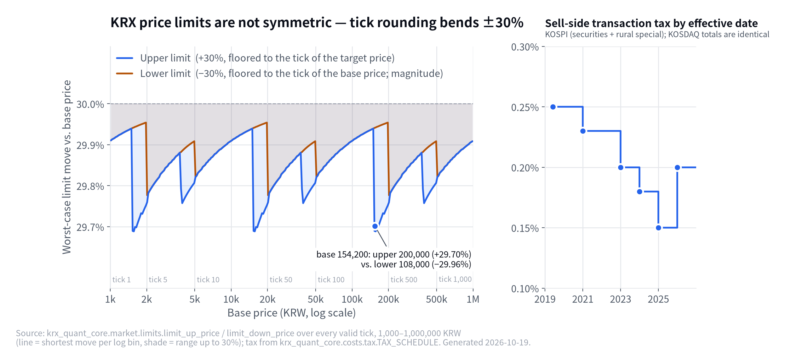

<div align="center">

<picture>
  <source media="(prefers-color-scheme: dark)" srcset="docs/images/brand/wordmark-dark.svg">
  
</picture>

# krx-quant-core

**한국 주식 퀀트 시스템이 시장 규칙을 한 군데서 맞추는 공통 코어입니다.**

상·하한가는 대칭이 아니고, 거래세는 시행일마다 다르며, 표본 외 구간은 한 번만 엽니다. 전략 코드는 포함하지 않습니다.

[](https://github.com/younghwan91/krx-quant-core/actions/workflows/ci.yml)
[](https://www.python.org/)
[](LICENSE)
[](https://www.linkedin.com/in/younghwan-chae/)

[Quick start](#quick-start) · [상세 가이드](docs/guide.md) · [English](README.en.md) · [Issues](https://github.com/younghwan91/krx-quant-core/issues)

</div>

<picture>
  <source media="(prefers-color-scheme: dark)" srcset="docs/images/hero-dark.png">
  
</picture>

<p align="center"><sub>기준가 구간별 상·하한가 비대칭 폭과 시행일별 증권거래세 계단</sub></p>

- **상한가와 하한가는 대칭이 아닙니다.** 기준가 154,200원의 상한가는 200,000원(+29.70%), 하한가는 108,000원(−29.96%)입니다. 규칙이 갈리는 `daily_bars` 130행 중 대칭식은 25행, 비대칭식은 105행을 맞혔습니다([실측 대조](docs/guide.md#가격제한폭--실측-대조)).
- **거래세는 날짜마다 다릅니다.** 2019년 0.25%에서 2025년 0.15%, 2026년 0.20%까지 여섯 단계로 바뀝니다. 비용 함수는 거래일을 받아 그날 세율을 적용합니다.
- **표본 외 구간은 한 번만 엽니다.** 실행 원장이 OOS 구간을 git에 잠그며, 최종 평가는 label당 한 번만 시작할 수 있습니다. 재시도도 거부합니다.

## Quick start

```bash
pip install krx-quant-core==0.9.0            # extras: [fast] numba · [opt] optuna · [db] psycopg · [evo] cmaes
```

```python
from datetime import date
from krx_quant_core.market import Market, limit_up_price, limit_down_price, shift_ticks
from krx_quant_core.costs import round_trip_cost, tax_rate

limit_up_price(24_250)          # 31500
limit_down_price(239_000)       # 167500.0
shift_ticks(49_950, 2)          # Decimal('50100') — 밴드 경계를 넘어도 유효 호가
tax_rate(date(2025, 6, 2), Market.KOSPI).total   # Decimal('0.0015')
round_trip_cost(date(2026, 9, 14), Market.KOSDAQ, slippage_one_way=0.0015)  # 0.0053
```

Python 3.11 이상이 필요합니다. 필수 의존성은 `kiwoom-client`(호가단위 표 정본), `numpy`, `pandas`뿐입니다. `[fast]`가 없어도 같은 커널을 파이썬으로 돌려 같은 숫자를 냅니다.

```bash
# 릴리스 전 기능이 필요하면 main의 커밋에 고정해 설치합니다:
pip install "krx-quant-core @ git+https://github.com/younghwan91/krx-quant-core@<커밋 sha>"
```

## 무엇이 들어 있나

| 모듈 | 하는 일 |
|---|---|
| `market/` | 종목코드 정규화·`Market`, 호가단위(스칼라·벡터·ETF), 상·하한가, KST 세션, 거래일 달력 |
| `costs/` | 시행일별 거래세 스케줄, `KoreanCostModel`(Decimal), `round_trip_cost`(float), `impact`(제곱근 충격 비용) |
| `execution/` | `OrderManager`·`InstanceLock`·`PositionBook`·`Broker`(`PaperBroker`·`KiwoomBroker`)·`EngineCore`·`OrderGuard` |
| `risk/` | DART 중대공시 분류·`RiskGate`, `DartDisclosureDB`, `KillSwitch`, `factor_model`(`RiskModel`), `attribution` |
| `backtest/` | 호가 스윕 VWAP·왕복비용, 지정가 체결 규칙, 트레이드 원장 지표, 횡단면 시뮬, `replay`, `drift`, `ticktime` |
| `backtest/lob/` | 틱·호가 → 초 격자 특징·경로(배치=실시간 공용 커널), 에피소드 시뮬, 무작위 대조군, 지정가 대기열 모델, `ceiling` |
| `data/` | 공용 DB `COPY` → 열 단위 `.npy` + `mmap`, 일봉·분봉·틱·호가 캐시, 정규장 기준가 복원, `risk_inputs.load_risk_inputs` |
| `stats/` | Deflated/Probabilistic Sharpe, t-haircut, purged walk-forward, 부트스트랩, 취약성, 선택편향, 층 매칭 대조군, `ic` |
| `portfolio/` | `optimize` — 팩터 위험모델 위 제약 평균-분산 최적화 (`[portfolio]` extra 필요) |
| `research/` | `run_sweep`(격자·병렬·캐시), `optuna_search`, `evolve`(BIPOP CMAwM·세대 프로토콜·짝 레이싱·봉인) |
| `runtime/` | 호스트 가드, 실행 기록 `start_run`, OOS 하드 잠금, `kqc` CLI(원격 실행·`nightly`·`pins`) |

각 전략 레포는 `krx-quant-core==X.Y.Z`로 버전을 고정해 사용합니다.

| 소비자 | 매매 스타일 | 실행 | 이 패키지에서 쓰는 기능 |
|---|---|---|---|
| [scalp-it](https://github.com/younghwan91/scalp-it) | 스캘핑 | 자동 실주문 | 호가·상한가·주문 가드·호가 스윕·체결 규칙·호스트 가드 |
| [daytrade-it](https://github.com/younghwan91/daytrade-it) | 데이트레이딩 | 자동 실주문 | 비용모델·공시 리스크 게이트·DART DB·코드 정규화·호스트 가드 |
| [swing-it](https://github.com/younghwan91/swing-it) | 스윙 | 리서치 + 수동 체결 | DSR·purged CV·부트스트랩·취약성 진단·횡단면 시뮬·진화 엔진·최적화 |

## 왜 따로 뺐나

세 레포가 같은 규칙을 각자 들고 있었고, 실제로 어긋나 있었습니다.

- **종목코드 정규화 불일치**: `normalize_code`가 두 레포에 복붙되어 있었고, 한쪽 옛 구현은 `0155E0`을 `001550`(전혀 다른 회사)으로 바꿨습니다.
- **흩어진 거래비용**: 거래비용이 레포마다 `0.0023`, `0.0034`, `0.0064`, `50bp`로 달랐고, 2023~2026년 세율 변경을 일자별로 적용하는 코드가 없었습니다.
- **반대 체결 판정**: 같은 레포 안에서도 알 수 없는 값을 받으면 한 곳은 `through`, 다른 곳은 `touch`로 반대로 읽었습니다.
- **누락된 하한가**: 하한가 계산이 없었고, 대칭식으로 짜면 실제 가격과 어긋납니다.

핵심 원칙은 네 가지입니다. 포트는 원본과 **수치 동일성**을 대조했고, 통계 함수는 **수치만 반환**(판정 금지)하며, 미검증 브로커 필드는 **`False` 플래그로 명시**하고, 공유 앱키의 **토큰 폐기를 금지**합니다.

## 문서

| 문서 | 내용 |
|---|---|
| [상세 가이드](docs/guide.md) | 가격제한폭 실측, 거래세 표, 실행 원장·OOS 잠금, 실매매 안전 규칙, LOB 체결 가정, 우위 판정, 데이터 층, 스윕·진화, 개발·로드맵 |
| [설계 문서](docs/superpowers/specs/) | 모듈별 설계 배경과 의사결정 기록 |
| [구현 계획](docs/superpowers/plans/) | 버전별 구현 계획 기록 |
| [릴리스 프로세스 다이어그램](docs/diagrams/release-process.html) | 배포·핀 동기화 흐름 그래프 |

## 기여 및 지원

- 버그 제보, 질문, 기능 제안은 [GitHub Issues](https://github.com/younghwan91/krx-quant-core/issues)에 남겨 주세요.
- 개발 환경 설정과 테스트 명령은 [상세 가이드의 개발 절](docs/guide.md#개발)을 참고하세요.
- **만든 사람**: **채영환 (Younghwan Chae)** · [GitHub @younghwan91](https://github.com/younghwan91) · [LinkedIn](https://www.linkedin.com/in/younghwan-chae/)

## 라이선스

[Apache-2.0](LICENSE)
